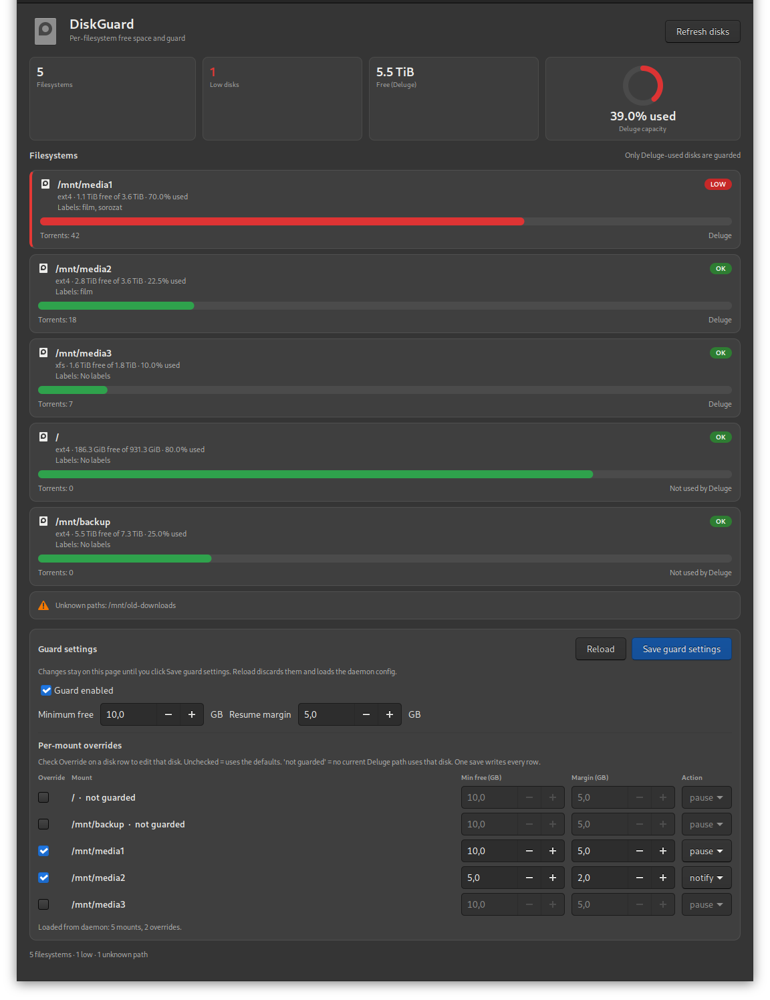
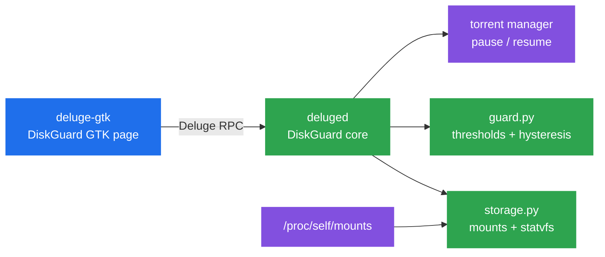

# DiskGuard

Per-filesystem free-space awareness and a low-disk guard for **Deluge 2.x**.
DiskGuard runs as a standalone core plugin in `deluged` and adds its own GTK
page in `deluge-gtk`; the stock 8112 `deluge-web` stays untouched.

[](https://github.com/gabordeli/diskguard/releases)
[](LICENSE)
[](https://www.python.org/)
[](https://deluge-torrent.org/)
[](https://github.com/gabordeli/diskguard/actions/workflows/release.yml)
[](https://ko-fi.com/gabordeli)

## 📸 Screenshot



Demo data from a fictional five-disk server. The page shows one low disk,
per-filesystem usage bars, an aggregate capacity ring and the batch guard
settings table.

## 📊 Status

Current release: **v0.1.0**. The styled GTK page, batch settings table,
status-bar item and plugin metadata are on `main` and will ship in the next
release.

- **Storage model:** real mounts from `/proc/self/mounts`, `statvfs`, `st_dev`
  grouping, bind-mount aliases and `unknown[]` paths.
- **Path mapping:** session, active torrent, completed torrent and Label
  `move_completed_path` targets.
- **Guard:** per-filesystem thresholds, hysteresis, `pause`/`notify` actions;
  only active download/check/move/queue states are paused, seeding is left
  alone, and a manual user pause is never resumed by the guard.
- **GTK page:** disk cards with LOW/OK badges, usage bars, a capacity ring and
  low-target warnings. `View` → `DiskGuard Storage` jumps straight to
  `Preferences` → `DiskGuard`.
- **Settings:** one table for all mounts, one **Save guard settings** action,
  an explicit **Reload** and an unsaved-changes indicator. Unchecked
  **Override** rows inherit the defaults.
- **Status bar:** a compact `N disks · X free` item next to the stock Deluge
  status items; a low disk turns it red and clicking it opens the page.
- **RPC:** the GTK client uses the existing Deluge session
  (`client.diskguard.*`); no second token, HTTP server or `webui2` dependency.
- **CI:** lint, tests with coverage, headless GTK import, Deluge
  2.0.3/2.1.1/2.2.0 compatibility, SonarQube quality gate, build, manual
  release and manual deploy.

## 🧱 Architecture



One egg contains both the core plugin and the GTK UI plugin. The core does the
mount discovery, `statvfs` work and torrent mutations; the GTK client only calls
the exported core methods and renders the payload.

## 🛡️ Guard semantics

- **LOW** when `free < min_free_bytes` for that mount.
- **OK** only when `free >= min_free_bytes + resume_margin_bytes`, so a disk
  does not flap on every poll.
- `pause` pauses only downloading/queued/checking/moving torrents on that
  filesystem. Seeding is not paused.
- Torrents paused by the guard are tracked separately; a manual pause is never
  undone by an `ok` transition.
- `notify` emits the transition without changing torrents.
- No auto-remove: completed data on a full disk is a cleanup decision.

The guard loop runs every 30 seconds. `statvfs` and payload building happen in
a thread, so a hung network mount cannot block the Deluge reactor.

## 📦 Data model

```json
{
  "disks": [
    {
      "mount": "/mnt/media1",
      "fs": "ext4",
      "total": 4000000000000,
      "free": 1200000000000,
      "used": 2800000000000,
      "used_pct": 0.70,
      "paths": ["/mnt/media1/downloads"],
      "torrents": 42,
      "labels": ["film", "sorozat"],
      "deluge": true,
      "low": true
    }
  ],
  "unknown": ["/mnt/old-downloads"]
}
```

Paths are grouped by `st_dev`, so bind mounts of the same filesystem do not
appear twice. The display mount is the longest matching mountpoint from
`/proc/self/mounts`.

## 🛠️ Development

```bash
python3 -m venv .venv
.venv/bin/pip install pytest pytest-cov ruff build twisted wheel setuptools

.venv/bin/pytest
.venv/bin/ruff check .
./scripts/package.sh          # dist/DiskGuard-<version>-py3.x.egg + .sha256

# Real GTK page without a daemon (Xvfb + Deluge/GTK installed):
PYTHONPATH=. xvfb-run -a python3 scripts/gtk_smoke.py

./scripts/release.sh patch --dry-run
```

The normal pytest run uses `tests/stubs`; the CI compatibility job sets
`DISKGUARD_REAL_DELUGE=1` to import real Deluge 2.x.

## 🚀 Installation

Build the egg and install it on the daemon and on the GTK client, then restart
both and enable `DiskGuard`:

```bash
./scripts/package.sh
install -m 644 dist/DiskGuard-*.egg /path/to/deluge/config/plugins/
```

On the target Deluge host, the helper can install and restart the daemon:

```bash
sudo DELUGE_CONFIG_DIR=/var/lib/deluged/config ./scripts/install.sh dist/DiskGuard-*.egg
```

Use `View` → `DiskGuard Storage` (or `Preferences` → `DiskGuard`) after the
client restart. Details and rollback: [docs/install.md](docs/install.md).

## 📚 Documentation

- [docs/install.md](docs/install.md) – egg install, config, verify and rollback
- [docs/api.md](docs/api.md) – payload and exported RPC methods
- [docs/design.md](docs/design.md) – storage model, guard semantics, GTK page
- [docs/decisions.md](docs/decisions.md) – decisions and constraints
- [docs/ci.md](docs/ci.md) – CI, release and deploy stages
- [AGENTS.md](AGENTS.md) – working notes for agents

## 🤝 Contributing

The GitHub repository is a **one-way, read-only mirror** of the private GitLab
development repository. Development happens on GitLab; GitHub issues/PRs may be
ported by the maintainer. See [CONTRIBUTING.md](CONTRIBUTING.md).

## ☕ Support

If the project is useful, you can support development via
[Ko-fi](https://ko-fi.com/gabordeli).
